<h1 align="center">nirholas</h1>

<b>I build open-source software: AI agents, MCP servers, 3D, on-chain tooling and developer tools.</b> 401 public repositories, each documented for people and for AI agents.

<picture><source media="(prefers-color-scheme: dark)" srcset="./assets/stats-dark.svg"/><source media="(prefers-color-scheme: light)" srcset="./assets/stats-light.svg"/></picture>

<picture><source media="(prefers-color-scheme: dark)" srcset="./assets/planet-dark.svg"/><source media="(prefers-color-scheme: light)" srcset="./assets/planet-light.svg"/></picture>

## About

I studied Marketing and Computer Science at the University of Washington and finished with a double bachelor's. I have done security research for Apple, AT&T, Microsoft, Google, the U.S. Department of Defense and the State of California. Before building open source full time I wrote full-stack software for some of the largest companies and brands, and I write and contribute at Entrepreneur Magazine.

Today I ship in public: AI agents, MCP servers, 3D, on-chain tooling and the developer tools around them, all documented so a person or a coding agent can pick them up cold.

## Start here

- [fresh-start](https://github.com/nirholas/fresh-start) ★6229: The original nirholas/claude-code before DMCA and take down. Once everything is cleared, it will return. Working with Anthropic and Github...
- [XActions](https://github.com/nirholas/XActions) ★579: ⚡ The Complete X/Twitter Automation Toolkit: Scrapers, MCP server for AI agents (Claude/GPT), CLI, browser scripts. No API fees. Open...
- [cryptocurrency.cv](https://github.com/nirholas/cryptocurrency.cv) ★319: Free crypto news API - real-time aggregator for Bitcoin, Ethereum, DeFi, Solana & altcoins. No API key required. RSS/Atom feeds, JSON REST...
- [three.ws](https://github.com/nirholas/three.ws) ★230: Open-source platform for 3D AI agents. Turn text or a photo into a rigged, animated GLB avatar, give it an LLM brain, memory and a wallet...
- [pump-fun-sdk](https://github.com/nirholas/pump-fun-sdk) ★134: Token creation launching, bonding curve trading, AMM migration, tiered fees, creator fee sharing, vanity keygen, MCP server, Telegram bot &...
- [PAI](https://github.com/nirholas/PAI) ★113: A complete private computer on a USB stick. PAI is a bootable Debian 12 Linux distro that runs Ollama locally on any x86_64 or ARM64...

<picture><source media="(prefers-color-scheme: dark)" srcset="./assets/top-stars-dark.svg"/><source media="(prefers-color-scheme: light)" srcset="./assets/top-stars-light.svg"/></picture>

## Where to focus

The repositories with the most momentum right now, ranked by stars per month of age, recent activity and how much each one feeds the others. Star counts are from October 11, 2026.

| Priority | Repository | Stars | Why it matters |
| --- | --- | --- | --- |
| 1 | [cryptocurrency.cv](https://github.com/nirholas/cryptocurrency.cv) | 319 | Fastest organic growth, about 34 stars a month, and a keyless API anyone can adopt in minutes. The data layer for the crypto repos. |
| 2 | [three.ws](https://github.com/nirholas/three.ws) | 231 | About 25 stars a month and the strongest product story: text or a photo in, a rigged 3D agent with a brain and a wallet out. It also generates this profile. |
| 3 | [XActions](https://github.com/nirholas/XActions) | 582 | The largest independently earned audience, 113 forks, and the biggest MCP-for-agents draw. Steady rather than spiking. |
| 4 | [pump-fun-sdk](https://github.com/nirholas/pump-fun-sdk) | 134 | The anchor of the Solana cluster ([pump-swap-sdk](https://github.com/nirholas/pump-swap-sdk), [pumpkit](https://github.com/nirholas/pumpkit), [pumpfun-claims-bot](https://github.com/nirholas/pumpfun-claims-bot)). Growth in one place lifts all of them. |
| 5 | [PAI](https://github.com/nirholas/PAI) | 113 | A private local-AI computer on a USB stick. Distinct from everything else here and easy to demo. |
| 6 | [agenti](https://github.com/nirholas/agenti) and [universal-crypto-mcp](https://github.com/nirholas/universal-crypto-mcp) | 80 and 42 | Agent wallets and x402 payments, the thread that ties the MCP and on-chain work together. |

Newest cluster to watch: the Robinhood Chain set ([robinhood-chain-trading-bot](https://github.com/nirholas/robinhood-chain-trading-bot), [robinhood-chain-alert-bot](https://github.com/nirholas/robinhood-chain-alert-bot), [robinhood-chain-kit](https://github.com/nirholas/robinhood-chain-kit), [robinhood-mcp](https://github.com/nirholas/robinhood-mcp), [robinhood-toolkit](https://github.com/nirholas/robinhood-toolkit)). About 47 stars across five repositories in under three months, all created in July 2026.

[fresh-start](https://github.com/nirholas/fresh-start) holds about 6,200 stars, most of the account total, so it dominates every ranking by raw numbers. It is left out of the list above because its own description says the content is pending a takedown resolution, and it is not a project to build on.

## By the numbers

Every chart below is rendered from the live GitHub listing each time the catalog is rebuilt, so the numbers are always current.

<picture><source media="(prefers-color-scheme: dark)" srcset="./assets/city-dark.svg"/><source media="(prefers-color-scheme: light)" srcset="./assets/city-light.svg"/></picture>

<picture><source media="(prefers-color-scheme: dark)" srcset="./assets/growth-dark.svg"/><source media="(prefers-color-scheme: light)" srcset="./assets/growth-light.svg"/></picture>
<picture><source media="(prefers-color-scheme: dark)" srcset="./assets/languages-dark.svg"/><source media="(prefers-color-scheme: light)" srcset="./assets/languages-light.svg"/></picture>

<picture><source media="(prefers-color-scheme: dark)" srcset="./assets/punchcard-dark.svg"/><source media="(prefers-color-scheme: light)" srcset="./assets/punchcard-light.svg"/></picture>

## How I build

Pulled from the GitHub API on October 11, 2026. Commit counts and streaks include private repositories as counts only. Lines and hours come from public repositories, with any commit over 20,000 changed lines left out as a bulk import. Hours are not a stopwatch: a day counts each clock hour (UTC) in which at least one commit landed, so it cannot pass 24.

<picture><source media="(prefers-color-scheme: dark)" srcset="./assets/activity-volume-dark.svg"/><source media="(prefers-color-scheme: light)" srcset="./assets/activity-volume-light.svg"/></picture>

<picture><source media="(prefers-color-scheme: dark)" srcset="./assets/activity-habit-dark.svg"/><source media="(prefers-color-scheme: light)" srcset="./assets/activity-habit-light.svg"/></picture>

<picture><source media="(prefers-color-scheme: dark)" srcset="./assets/activity-calendar-dark.svg"/><source media="(prefers-color-scheme: light)" srcset="./assets/activity-calendar-light.svg"/></picture>

<picture><source media="(prefers-color-scheme: dark)" srcset="./assets/activity-lines-dark.svg"/><source media="(prefers-color-scheme: light)" srcset="./assets/activity-lines-light.svg"/></picture>

<picture><source media="(prefers-color-scheme: dark)" srcset="./assets/activity-hours-dark.svg"/><source media="(prefers-color-scheme: light)" srcset="./assets/activity-hours-light.svg"/></picture>

<picture><source media="(prefers-color-scheme: dark)" srcset="./assets/activity-rhythm-dark.svg"/><source media="(prefers-color-scheme: light)" srcset="./assets/activity-rhythm-light.svg"/></picture>

- Busiest day: January 26, 2026 with 5,417 commits.
- Biggest day for lines: August 7, 2026 with 775,578 lines changed.
- Most hours with a push in one day: 24 on January 9, 2026.
- Last 30 days: 3,103 commits, 1,036,134 lines added and 138,527 removed, pushes in 123 separate hours on 28 active days.
- Current streak: 4 days. Longest: 127 days, ending August 30, 2026.

| Where the lines went | Commits | Added | Removed |
|---|---:|---:|---:|
| [three.ws](https://github.com/nirholas/three.ws) | 9,192 | 5,025,624 | 1,255,412 |
| [cryptocurrency.cv](https://github.com/nirholas/cryptocurrency.cv) | 1,127 | 1,196,125 | 202,050 |
| [three-ui](https://github.com/nirholas/three-ui) | 533 | 446,945 | 132,368 |
| [XActions](https://github.com/nirholas/XActions) | 438 | 425,537 | 58,802 |
| [crypto-vision](https://github.com/nirholas/crypto-vision) | 142 | 268,018 | 27,752 |
| [universal-crypto-mcp](https://github.com/nirholas/universal-crypto-mcp) | 417 | 241,508 | 23,590 |
| [crypto-data-aggregator](https://github.com/nirholas/crypto-data-aggregator) | 85 | 122,439 | 26,303 |
| [pump-fun-sdk](https://github.com/nirholas/pump-fun-sdk) | 3,602 | 110,057 | 13,045 |

## Find your way

Use the repository topics on the left of any repo, or jump to a section below. Every repo ships a README, an [AGENTS.md](https://agents.md) and an [llms.txt](https://llmstxt.org) so a coding agent can pick it up cold. The full machine-readable list is [repos.json](./repos.json).

- [Robinhood Chain](#robinhood-chain) (22)
- [x402 payments and agent commerce](#x402-payments-and-agent-commerce) (84)
- [MCP servers for AI agents](#mcp-servers-for-ai-agents) (56)
- [3D AI agents and avatars](#3d-ai-agents-and-avatars) (59)
- [Solana and pump.fun tooling](#solana-and-pumpfun-tooling) (24)
- [DeFi mechanisms and Uniswap v4 hooks](#defi-mechanisms-and-uniswap-v4-hooks) (54)
- [On-chain experiments and collectibles](#on-chain-experiments-and-collectibles) (74)
- [Developer tools and everything else](#developer-tools-and-everything-else) (28)

## Robinhood Chain

SDKs, bots, alerts and tooling for Robinhood Chain.

22 repositories

- [robinhood-chain-alert-bot](https://github.com/nirholas/robinhood-chain-alert-bot) ★11: Real-time alert bot for Robinhood Chain - Telegram, Discord, and X (Twitter). Tracks new launches, graduations, whale trades, Stock Token...
- [robinhood-chain-trading-bot](https://github.com/nirholas/robinhood-chain-trading-bot) ★11: Open-source autonomous trading bot for Robinhood Chain. Four strategies: launch sniping, momentum, Stock Token premium/discount arbitrage...
- [robinhood-trading-bot](https://github.com/nirholas/robinhood-trading-bot) ★11: Automated Robinhood Crypto trading bot: rule-based entries on new pair launches (holders, dev buy, liquidity, momentum) plus copy trading...
- [robinhood-chain-kit](https://github.com/nirholas/robinhood-chain-kit) ★9: Power-user toolkit for Robinhood Chain: real-time streams, read-through caching, multicall batching, a local SQLite indexer, agent strategy...
- [robinhood-mcp](https://github.com/nirholas/robinhood-mcp) ★9: Model Context Protocol servers for the official Robinhood Crypto Trading API: the credentialed brokerage API at trading.robinhood.com...
- [robinhood-chain-alerts](https://github.com/nirholas/robinhood-chain-alerts) ★7: Telegram + Discord alert bots for Robinhood Chain memecoins: new launches, graduations, whale trades. Hosted service, free + premium tier.
- [robinhood-chain-cli](https://github.com/nirholas/robinhood-chain-cli) ★7: The command-line toolkit for Robinhood Chain: instant reads with zero config, guarded writes with a wallet. The gh/vercel of Robinhood...
- [robinhood-chain-erc8056](https://github.com/nirholas/robinhood-chain-erc8056) ★7: Reference implementation and canonical explainer for ERC-8056 (uiMultiplier()), the corporate-actions standard behind Robinhood's Stock...
- [robinhood-chain-launcher](https://github.com/nirholas/robinhood-chain-launcher) ★7: Autonomous coin launcher for Robinhood Chain: concept → 3D logo → deploy on NOXA or Uniswap v3 → announce. CLI, HTTP API, and an autonomous...
- [robinhood-chain-pay](https://github.com/nirholas/robinhood-chain-pay) ★7: Stripe-Checkout-grade USDG payments for Robinhood Chain: embeddable widget, hosted payment links, merchant verification library. npm...
- [robinhood-chain-sdk](https://github.com/nirholas/robinhood-chain-sdk) ★7: TypeScript SDK for Robinhood Chain: Stock Tokens, Chainlink quotes, multiplier-correct portfolios, Uniswap v3 swaps, USDG, launchpad...
- [robinhood-chain-x402](https://github.com/nirholas/robinhood-chain-x402) ★7: x402 payment rail for USDG on Robinhood Chain: spec-conformant exact/EIP-3009 middleware, client fetch wrapper, self-hostable facilitator.
- [robinhood-toolkit](https://github.com/nirholas/robinhood-toolkit) ★7: Build on Robinhood Chain and Robinhood Crypto: verified network constants, a chain SDK, a read-only MCP server, runnable examples, and 64...
- [learn-robinhood-chain](https://github.com/nirholas/learn-robinhood-chain) ★6: The definitive learning site for Robinhood Chain: from your first RPC read to shipping an autonomous agent. Every tutorial verified...
- [robinhood-chain-api](https://github.com/nirholas/robinhood-chain-api) ★6: Hosted market-data API for Robinhood Chain: Stock Tokens with Chainlink + DEX premium/discount, memecoin launchpads, portfolios...
- [robinhood-chain-connect](https://github.com/nirholas/robinhood-chain-connect) ★6: Wallet + onboarding kit for Robinhood Chain dApps: one component for "add network → fund via bridge → connect" (no wagmi connector kit...
- [robinhood-chain-examples](https://github.com/nirholas/robinhood-chain-examples) ★6: Runnable code examples for building on Robinhood Chain: SDK snippets, live price tickers, firehose consumers, agent scripts.
- [robinhood-chain-js](https://github.com/nirholas/robinhood-chain-js) ★6: The 5-lines-to-your-first-trade wrapper for Robinhood Chain. One import, sensible defaults, promise-first, browser + Node: prices...
- [robinhood-chain-mcp](https://github.com/nirholas/robinhood-chain-mcp) ★6: Model Context Protocol servers for Robinhood Chain: zero-config read-only data server plus an opt-in trading server with hard spend caps...
- [robinhood-chain-traders](https://github.com/nirholas/robinhood-chain-traders) ★6: A framework and runnable fleet of autonomous agents that trade Robinhood Chain memecoins and watch Stock Token premium/discount: real...
- [robinhood-volume-alerts](https://github.com/nirholas/robinhood-volume-alerts) ★6: Telegram bot for Robinhood Chain crypto (chain ID 4663). It watches every DEX trade on the chain, learns each token's normal per-minute...
- [hood-oracle](https://github.com/nirholas/hood-oracle) ★4: Autonomous Robinhood Chain launch trader: a learning conviction oracle scores every NOXA and Odyssey launch, arm-and-guardrail controls...

## x402 payments and agent commerce

Pay-per-call APIs and the clients, gates and facilitators that let agents buy.

84 repositories

- [three.ws](https://github.com/nirholas/three.ws) ★230: Open-source platform for 3D AI agents. Turn text or a photo into a rigged, animated GLB avatar, give it an LLM brain, memory and a wallet...
- [agenti](https://github.com/nirholas/agenti) ★80: Give any AI agent a crypto wallet. Agents deserve access to money. Pay x402 APIs, receive USDC, check balances: autonomously. Works with...
- [x402-deploy](https://github.com/nirholas/x402-deploy) ★25: Turn any API or MCP server into a paid service with x402
- [modelcontextprotocol.name](https://github.com/nirholas/modelcontextprotocol.name) ★20: Give AI agents access to money 💰1,100+ MCP tools: swap, bridge, stake, lend, trade, and deploy across most blockchains. The open MCP...
- [solana-marketplace-escrow](https://github.com/nirholas/solana-marketplace-escrow) ★9: Solana escrow SDK: non-custodial, smart-contract escrow where the vault has no private key, so moderators can release funds but never steal...
- [solana-sniper-mcp](https://github.com/nirholas/solana-sniper-mcp) ★9: Lightweight, embeddable pump.fun sniper engine for 3D AI agents: multi-agent, multi-user, with pluggable wallet/store/RPC adapters. Library...
- [image-analysis-mcp](https://github.com/nirholas/image-analysis-mcp) ★8: Image analysis and visual understanding tools for AI agents: describe, detect, extract from any image.
- [3d-agent-mcp](https://github.com/nirholas/3d-agent-mcp) ★7: MCP tools for the 3d-agent stack: free text→3D (TRELLIS) plus paid 3D/avatar/rigging, pump.fun snapshots, ERC-8004 reputation, vanity...
- [crypto-signals-mcp](https://github.com/nirholas/crypto-signals-mcp) ★7: Discover, subscribe to, and track three.ws copy-trade signal feeds from any AI agent: a marketplace ranked by proven realized edge, a...
- [ibm-x402-mcp](https://github.com/nirholas/ibm-x402-mcp) ★7: x402 pay-per-use MCP server for IBM Granite AI: chat, code, embeddings, analysis, and time-series forecasting. Pay USDC on Solana per call....
- [solana-vanity-mcp](https://github.com/nirholas/solana-vanity-mcp) ★7: Read the three.ws vanity-address grind-bounty market and proof-of-grind rarity gallery from any AI agent. Quote a pattern's difficulty +...
- [three-token-mcp](https://github.com/nirholas/three-token-mcp) ★7: The first MCP server whose actions burn a token. Let any AI agent price, hold, and burn $THREE on-chain: every burn splits to the...
- [vscode-x402](https://github.com/nirholas/vscode-x402) ★7: Browse the x402 bazaar, decode 402 payment challenges, and pay per call for paid APIs and MCP tools in USDC or $THREE on Solana and Base...
- [x402-bridge](https://github.com/nirholas/x402-bridge) ★7: MCP stdio bridge that turns any x402-paid HTTP endpoint into a Claude-callable tool. Auto-pays via the @x402 client (EVM exact, SVM exact...
- [x402-facilitator](https://github.com/nirholas/x402-facilitator) ★7: x402 payment facilitator: verifies and settles EIP-3009 micropayments multichain. v2 facilitator.
- [x402-fetch](https://github.com/nirholas/x402-fetch) ★7: Drop-in fetch wrapper that automatically pays x402 payment challenges with USDC on Base
- [x402-modal](https://github.com/nirholas/x402-modal) ★7: A drop-in payment modal for any x402 paid endpoint. One <script> tag turns an HTTP 402 Payment Required into a polished checkout: discover...
- [x402-payment-modal](https://github.com/nirholas/x402-payment-modal) ★7: The complete drop-in checkout for any x402 paid endpoint: wallet connect, sign, settle, receipt.
- [x402-payments-mcp](https://github.com/nirholas/x402-payments-mcp) ★7: Give any AI agent a self-custodial x402 wallet. Search the live bazaar, inspect an endpoint's price without paying, and pay_and_call any...
- [x402-server](https://github.com/nirholas/x402-server) ★7: The merchant side of x402: turn any HTTP endpoint into a paid one. Issue 402 challenges, price SKUs, verify and settle the X-PAYMENT header...
- [onchain-agent-wallets](https://github.com/nirholas/onchain-agent-wallets) ★6: Give an AI agent a real Solana wallet without giving it your money. The agent gets a spending allowance the SPL Token program enforces...
- [x402-agent-wallet](https://github.com/nirholas/x402-agent-wallet) ★6: Wallet policy daemon for agents: budgets, per-merchant caps, approval thresholds, signed policy verdicts
- [x402-mcp-commerce](https://github.com/nirholas/x402-mcp-commerce) ★6: MCP server that gives Claude/GPT agents commerce tools: each tool call pays an upstream x402 endpoint and returns its artifact
- [agentcore-payments-mcp](https://github.com/nirholas/agentcore-payments-mcp) ★5: Platform-managed agent payment sessions: create a budget, pay any x402 endpoint without holding a private key. Governed by spend limits...
- [x402-activities](https://github.com/nirholas/x402-activities) ★5: Tours and activities search via Amadeus: agents find bookable experiences by location, paid per query in USDC on Base or Solana via x402
- [x402-agent-sandbox](https://github.com/nirholas/x402-agent-sandbox) ★5: A fake town on testnet: mock restaurant, hotel, and store implementing the suite's exact contracts, for end-to-end agent purchase testing
- [x402-approval-page](https://github.com/nirholas/x402-approval-page) ★5: Human-in-the-loop checkout: agent requests approval above its cap, human pays via the drop-in modal, agent fetches the signed outcome
- [x402-bookable](https://github.com/nirholas/x402-bookable) ★5: Self-hosted Calendly with x402: salons, doctors, consultants sell appointment slots directly to agents and humans
- [x402-books](https://github.com/nirholas/x402-books) ★5: Agents buy clean, chaptered full-text public-domain books: OpenLibrary search, Gutenberg delivery, in-response, paid in USDC on Base or...
- [x402-browser-bridge](https://github.com/nirholas/x402-browser-bridge) ★5: Framework that turns any website flow into an x402-paid API: declare a flow in YAML, Puppeteer executes, artifact returned in-response
- [x402-campsites](https://github.com/nirholas/x402-campsites) ★5: Campground search and availability from the official Recreation.gov RIDB API, per-lookup pricing
- [x402-carbon](https://github.com/nirholas/x402-carbon) ★5: Grid carbon intensity now and best-window scheduling: keyless live data for green agents, paid with x402: USDC on Base or Solana.
- [x402-classes](https://github.com/nirholas/x402-classes) ★5: Class and session booking server: fitness studios and workshop hosts sell seats per-class via x402
- [x402-concierge](https://github.com/nirholas/x402-concierge) ★5: Meta-agent that composes paid skills: dinner + gift + transit in one request, with per-step receipts, powered by the suite
- [x402-confirmations](https://github.com/nirholas/x402-confirmations) ★5: Normalize any booking confirmation into a portable record: ICS invite and status snapshots per query
- [x402-disputes](https://github.com/nirholas/x402-disputes) ★5: Arbitration for failed real-world tasks: signed case records with evidence hashes, status snapshots, and signed rulings
- [x402-domains](https://github.com/nirholas/x402-domains) ★5: Authoritative domain availability and expiry intel via RDAP: keyless, live, per lookup. Paid per call in USDC on Base or Solana via x402.
- [x402-events](https://github.com/nirholas/x402-events) ★5: Event search and on-sale checks over Ticketmaster Discovery: agents find real events and ticket windows, paid in USDC on Base or Solana via...
- [x402-flight-search](https://github.com/nirholas/x402-flight-search) ★5: Pay-per-query flight search over the Amadeus API: offers, live pricing, and fare-drop checks for agents
- [x402-gift-agent](https://github.com/nirholas/x402-gift-agent) ★5: Fund someone else's agent task: buy a signed gift voucher, recipient's agent redeems it for execution with receipts
- [x402-github-bounty](https://github.com/nirholas/x402-github-bounty) ★5: Fund GitHub issues with x402: signed bounty certificates, merged-PR verification reports, settlement receipts. Non-custodial; pay in USDC...
- [x402-group-pay](https://github.com/nirholas/x402-group-pay) ★5: Split one booking across N wallets: the 6-person dinner problem: pooled x402 contributions with signed receipts and funded proofs
- [x402-hotel-search](https://github.com/nirholas/x402-hotel-search) ★5: Pay-per-query hotel search and offer pricing over Amadeus: agents shop rooms without accounts
- [x402-markets](https://github.com/nirholas/x402-markets) ★5: Crypto prices via CoinGecko and SEC filings via EDGAR: real market data per lookup, paid with x402: USDC on Base or Solana.
- [x402-movies](https://github.com/nirholas/x402-movies) ★5: Movie catalog concierge over TMDB: search, details, and recommendations per query, paid in USDC on Base or Solana via x402
- [x402-negotiator](https://github.com/nirholas/x402-negotiator) ★5: Agent-to-agent price negotiation instruments: signed offers, counters, and agreements, each returned in-response
- [x402-news-wire](https://github.com/nirholas/x402-news-wire) ★5: Global news query service over GDELT: article sets, coverage timelines, and delta pulses, paid per query with x402: USDC on Base or Solana.
- [x402-notify](https://github.com/nirholas/x402-notify) ★5: Real message delivery per-message: Telegram bot messages and SMTP email with delivery receipts in-response
- [x402-otp-relay](https://github.com/nirholas/x402-otp-relay) ★5: The 'code sent to your email' step, solved for agents: paid relay mailboxes, retrieved OTP codes returned in-response
- [x402-places](https://github.com/nirholas/x402-places) ★5: POI concierge over OpenStreetMap Overpass with optional Yelp enrichment: restaurants, cafes, anything, per query, paid in USDC on Base or...
- [x402-podcasts](https://github.com/nirholas/x402-podcasts) ★5: Podcast search and episode intel over the Podcast Index API, per query. Pay in USDC on Base or Solana via x402.
- [x402-price-watch](https://github.com/nirholas/x402-price-watch) ★5: Pay-per-poll price watching: every check returns a fresh snapshot plus delta vs your cursor (flights via Amadeus, crypto via CoinGecko)
- [x402-print-mail](https://github.com/nirholas/x402-print-mail) ★5: Agents send physical letters and postcards via Lob's test environment: preview PDF returned in-response
- [x402-queue](https://github.com/nirholas/x402-queue) ★5: Live waitlist server: pay to join a queue, receive a signed position token, auto-refund if never served
- [x402-rebooker](https://github.com/nirholas/x402-rebooker) ★5: The cancel-worse-book-better move, automated: scans real inventory (Amadeus/RIDB) against your current booking, returns an actionable...
- [x402-receipts](https://github.com/nirholas/x402-receipts) ★5: Receipts and accounting for agent spending: enriched on-chain receipt lookups and ledger exports
- [x402-recurring](https://github.com/nirholas/x402-recurring) ★5: Standing orders for agents: mandate documents plus a client-side scheduler that pays per run and collects run reports
- [x402-refund-hold](https://github.com/nirholas/x402-refund-hold) ★5: The $0.01 refundable-hold pattern as drop-in Express middleware: charge a hold, auto-refund on failure, ledger included
- [x402-rentals](https://github.com/nirholas/x402-rentals) ★5: Time-slot rental server for courts, rooms, and equipment: reserve and pay per block with x402
- [x402-reputation](https://github.com/nirholas/x402-reputation) ★5: Did the merchant actually deliver? Reliability scores computed from signed fulfillment attestations
- [x402-research](https://github.com/nirholas/x402-research) ★5: Scholarly search over arXiv, Crossref, and Semantic Scholar: papers, citation graphs, formatted bibliographies. Paid per query with x402...
- [x402-shipping](https://github.com/nirholas/x402-shipping) ★5: Rate shopping and label generation via Shippo/EasyPost test mode: agents ship things, label returned in-response
- [x402-shop-scout](https://github.com/nirholas/x402-shop-scout) ★5: Live marketplace intelligence over eBay Browse: listings search and is-this-a-deal verdicts
- [x402-skill-md](https://github.com/nirholas/x402-skill-md) ★5: The skill.md toolkit: generate and validate agent-discoverable skill files (the agentres.dev pattern) from OpenAPI specs. Defines the...
- [x402-skill-registry](https://github.com/nirholas/x402-skill-registry) ★5: Searchable registry of x402-paid agent skills: register with a signed listing, agents search per query. Every listing accepts USDC on both...
- [x402-storefront](https://github.com/nirholas/x402-storefront) ★5: Self-hosted store with x402 checkout: sell digital goods (delivered in-response) and physical goods (signed order confirmation)
- [x402-transfer-market](https://github.com/nirholas/x402-transfer-market) ★5: Transfer or resell held bookings between wallets: signed listings and reassigned booking tokens, all in-response
- [x402-transit](https://github.com/nirholas/x402-transit) ★5: Transit trip planning and live delay snapshots from open GTFS/GTFS-RT feeds, priced per query
- [x402-weather-guard](https://github.com/nirholas/x402-weather-guard) ★5: Go/no-go weather decisions for plans: hourly forecasts and verdicts from Open-Meteo and NWS, keyless and live, paid with x402: USDC on Base...
- [x402-account-link](https://github.com/nirholas/x402-account-link) ★4: One-time account linking vault for agent flows: encrypted credential links with scoped, expiring access tokens
- [x402-gate](https://github.com/nirholas/x402-gate) ★4: Makes the pool an x402 resource server: a swapper that presents a signed x402 payment gets a cheaper fee on that swap, and the payment...
- [x402-grocery](https://github.com/nirholas/x402-grocery) ★4: Real grocery product search and cart building over the Kroger API, priced per operation
- [x402-suite](https://github.com/nirholas/x402-suite) ★4: Fifty open-source services that let AI agents buy real things: booking, travel, shopping, and the infrastructure underneath, priced per...
- [x402-tablebook](https://github.com/nirholas/x402-tablebook) ★4: Open-source Resy: a self-hosted restaurant reservation server that AI agents can book via x402 refundable holds
- [knock-mcp](https://github.com/nirholas/knock-mcp) ★3: Let an agent reach a real person. Read what someone charges for one message, browse every open door, knock, and read the reply. Paid doors...
- [three-ws-knock](https://github.com/nirholas/three-ws-knock) ★3: Reach a real person, and pay their price to do it. Every three.ws account can publish a priced door; paying it buys one message through...
- [x402-preflight](https://github.com/nirholas/x402-preflight) ★3: Ask an x402 seller whether it can actually settle, before you sign anything. Fetches and verifies a signed, time-bounded payability...
- [agent-capability-card](https://github.com/nirholas/agent-capability-card) ★2: Generate machine-readable agent endpoint, pricing, and capability metadata.
- [agent-runtime](https://github.com/nirholas/agent-runtime) ★1: The three.ws agent engine: a plan/execute decision loop with human-approval gates, a seven-layer GuardChain (security blacklist...
- [papertrade-x402](https://github.com/nirholas/papertrade-x402) ★1: Pay-per-call Papertrade intelligence API for AI agents over x402: liquidation risk, liquidation maps, settlement estimates and top-trader...
- [three-ws-names](https://github.com/nirholas/three-ws-names) ★1: ENS + SNS name resolution, *.threews.sol subdomain minting, and pay-by-name in one import. The three.ws agent-identity SDK.
- [knock-sdk](https://github.com/nirholas/knock-sdk): Reach a real person, and pay their price to do it. Every three.ws account can publish a priced door; paying it buys one message through...
- [names](https://github.com/nirholas/names): ENS + SNS name resolution, *.threews.sol subdomain minting, and pay-by-name in one import. The three.ws agent-identity SDK.
- [three-ws-knock-sdk](https://github.com/nirholas/three-ws-knock-sdk): Reach a real person, and pay their price to do it. Every three.ws account can publish a priced door; paying it buys one message through...

## MCP servers for AI agents

Model Context Protocol servers that give any MCP client new abilities.

56 repositories

- [XActions](https://github.com/nirholas/XActions) ★579: ⚡ The Complete X/Twitter Automation Toolkit: Scrapers, MCP server for AI agents (Claude/GPT), CLI, browser scripts. No API fees. Open...
- [universal-crypto-mcp](https://github.com/nirholas/universal-crypto-mcp) ★42: Universal MCP server for AI agents to interact with any* blockchain via natural language and plugins. Supports swaps, bridges, gas...
- [extract-llms-docs](https://github.com/nirholas/extract-llms-docs) ★34: Extract documentation for AI agents from any site with llms.txt support. Features MCP server, REST API, batch processing, and multiple...
- [github-to-mcp](https://github.com/nirholas/github-to-mcp) ★32: Convert GitHub repositories to MCP servers automatically. Extract tools from OpenAPI, GraphQL & REST APIs for Claude Desktop, Cursor...
- [mcp-notify](https://github.com/nirholas/mcp-notify) ★29: Monitor the Model Context Protocol (MCP) Registry for new, updated, and removed servers. Get real-time notifications via Discord, Slack...
- [pump-fun-workers](https://github.com/nirholas/pump-fun-workers) ★17: A Cloudflare Worker that implements the MCP Streamable HTTP transport for AI agents to interact with pump.fun on Solana.
- [automate-glama-submit](https://github.com/nirholas/automate-glama-submit) ★15: Bulk-submit all your MCP server repos to glama.ai in one command.
- [loom-mcp](https://github.com/nirholas/loom-mcp) ★10: Loom: the three.ws community 3D-creation gallery from any AI agent. Browse the public feed of community-forged GLB creations, fetch one...
- [audio-mcp](https://github.com/nirholas/audio-mcp) ★9: Give 3D AI agents a voice and a face from any MCP client: text-to-speech, speech-to-text, audio-to-face lipsync (ARKit blendshapes), and...
- [pumpfun-mcp](https://github.com/nirholas/pumpfun-mcp) ★9: Free, read-only pump.fun + Solana MCP server: token discovery, on-chain bonding-curve & holder analysis, creator fee-claim tracking, SNS...
- [3D-AR-Studio](https://github.com/nirholas/3D-AR-Studio) ★8: Drop a full augmented-reality studio into any web page. Place any number of 3D models in your real room through the camera, generate new...
- [3d-scene-mcp](https://github.com/nirholas/3d-scene-mcp) ★8: Build and manipulate 3D scenes from natural language via AI agents.
- [copy-mcp](https://github.com/nirholas/copy-mcp) ★8: Manage your three.ws copy-trade follows from any AI agent: follow/unfollow leaders, tune sizing & guard rules, read the copy-intent inbox...
- [intel-mcp](https://github.com/nirholas/intel-mcp) ★8: three.ws market intelligence from any AI agent: smart-money scoring, wallet intel, signal feeds, KOL leaderboards/trades, and the...
- [activity-mcp](https://github.com/nirholas/activity-mcp) ★7: three.ws live discovery surface from any AI agent: trending agents and coins, the $THREE holder leaderboard with tiers, and the site-wide...
- [ai-tutor-mcp](https://github.com/nirholas/ai-tutor-mcp) ★7: three.ws Pay-As-You-Learn tutor ledger from any AI agent: read a learning session's itemized running tab and close it for an attested...
- [alerts-mcp](https://github.com/nirholas/alerts-mcp) ★7: Manage your three.ws pump.fun alert rules from any AI agent: create, update, and delete monitoring rules with in-app, webhook, and Telegram...
- [alibaba-cloud-mcp](https://github.com/nirholas/alibaba-cloud-mcp) ★7: MCP server for Alibaba Cloud DashScope by three.ws: Qwen chat, embeddings, and model discovery using your own Alibaba Cloud API key.
- [autopilot-mcp](https://github.com/nirholas/autopilot-mcp) ★7: An AI agent's own autonomous-execution control plane over MCP: set autopilot scopes, a daily SOL spend cap, and auto-execute, then run the...
- [avatar-agent-mcp](https://github.com/nirholas/avatar-agent-mcp) ★7: 3D AI Agent Avatar: MCP server that spawns a textured GLB avatar, inspects/validates/optimizes any 3D model, gives the agent a Solana...
- [billing-mcp](https://github.com/nirholas/billing-mcp) ★7: An AI agent's own account economics over MCP: plan quotas, metered usage, invoices, receipts, and earnings. Read-only, account-scoped....
- [brain-mcp](https://github.com/nirholas/brain-mcp) ★7: Any model, one interface: the three.ws multi-provider LLM router over MCP. Discover available providers/models (Claude, GPT-5, Grok, Qwen...
- [clash-mcp](https://github.com/nirholas/clash-mcp) ★7: Play three.ws Coin Clash: the community faction war backed by real holdings + pump.fun data: from any AI agent. Read the live battle board...
- [crypto-portfolio-mcp](https://github.com/nirholas/crypto-portfolio-mcp) ★7: An AI agent's own trading state over MCP: portfolio summary, value history, live wallet balances, the public closed-trade PnL feed, and one...
- [ibm-watsonx-mcp](https://github.com/nirholas/ibm-watsonx-mcp) ★7: MCP server for IBM watsonx.ai by three.ws: chat, text generation, embeddings, tokenization, and model discovery with IBM Granite foundation...
- [kol-mcp](https://github.com/nirholas/kol-mcp) ★7: Track one smart trader from any AI agent: a tracked KOL wallet's portfolio P&L (realized/unrealized, win rate, top holding) and its trades...
- [nft-marketplace-mcp](https://github.com/nirholas/nft-marketplace-mcp) ★7: Browse the three.ws agent marketplace and skills catalog from any AI agent. browse_agents and browse_skills search & page the public...
- [provenance-mcp](https://github.com/nirholas/provenance-mcp) ★7: The three.ws agent action-provenance log over MCP: append-only, ERC-191-signed, on-chain-verifiable. Any AI agent can record what it did...
- [push-notifications-mcp](https://github.com/nirholas/push-notifications-mcp) ★7: Read and manage your three.ws notification inbox from any AI agent: list inbound events (pump/market alerts, sales, purchases, social, IRL...
- [threews-avatar-mcp](https://github.com/nirholas/threews-avatar-mcp) ★7: MCP server for three.ws 3D avatars by three.ws: render a live, rotatable on-chain avatar inline (interactive MCP App), get a paste-anywhere...
- [token-naming-mcp](https://github.com/nirholas/token-naming-mcp) ★7: Resolve Solana .sol names and check *.threews.sol agent-identity availability from any AI agent. sns_resolve maps a .sol name to its owner...
- [create2-vanity](https://github.com/nirholas/create2-vanity) ★5: Model deterministic EVM CREATE2 addresses and salt search difficulty.
- [hookforge](https://github.com/nirholas/hookforge) ★5: 50 production Uniswap v4 hooks: novel AMM mechanisms, Solidity + Foundry, a TypeScript SDK, an MCP server for agents, and a 3D docs site....
- [evm-vanity](https://github.com/nirholas/evm-vanity) ★4: Open-source EVM vanity wallet generator: grind a 0x address in your browser, delegate hard patterns with secp256k1 split-key grinding that...
- [solana-vanity](https://github.com/nirholas/solana-vanity) ★4: Open-source Solana vanity address generator: WebAssembly Ed25519 grinding in the browser, an exact Base58 difficulty model, signed...
- [herald-mcp](https://github.com/nirholas/herald-mcp) ★3: Let an AI agent tell its human something in person: a 3D character walks onto the browser tab they have open and says it out loud. Announce...
- [home-bridge](https://github.com/nirholas/home-bridge) ★3: Connect a three.ws agent to a real Home Assistant instance: live entity state, safe service calls, a room graph for the 3D scene, and the...
- [home-mcp](https://github.com/nirholas/home-mcp) ★3: Give any MCP assistant safe control of a real Home Assistant house: floors, rooms and live state, the household's own scenes, and service...
- [three-ws-portal](https://github.com/nirholas/three-ws-portal) ★3: Turn any website into a walkable 3D world. Reads a page's real structure and lays out a city from it: sections become buildings, links...
- [pulse](https://github.com/nirholas/pulse) ★2: Open-source market intelligence for the Solana and Robinhood Chain trenches: launches, runners, wallets, daily Telegram newsletter...
- [assistant-mcp](https://github.com/nirholas/assistant-mcp) ★1: Generate a paste-ready three.ws assistant widget from any AI agent. build_assistant_widget turns a config into an embeddable <script> tag...
- [blender-mcp](https://github.com/nirholas/blender-mcp) ★1: Drive the Blender on your machine from any AI agent, headless. Inspect a 3D file, convert between...
- [concierge-mcp](https://github.com/nirholas/concierge-mcp) ★1: Ask any website's AI concierge a grounded question, and generate the copy-paste embed code to add a three.ws Concierge (an AI chat widget...
- [mcp-policy](https://github.com/nirholas/mcp-policy) ★1: The three.ws MCP tool policy: every tool's group and tier, read-only by default with opt-in financial groups, named confirm flags, and...
- [spatial-mcp](https://github.com/nirholas/spatial-mcp) ★1: Validator, builder, and conformance fixtures for Spatial MCP: the open (CC0) shape for returning a live, interactive 3D scene as a...
- [three-ws](https://github.com/nirholas/three-ws) ★1: One command to connect any MCP client to three.ws: sign in with OAuth or an API key, write the three.ws MCP servers into Claude Code...
- [three-ws-agent](https://github.com/nirholas/three-ws-agent) ★1: Run a three.ws agent on your own machine or VPS: a terminal UI with slash commands, streaming tool output, local file and shell tools in a...
- [three-ws-cli](https://github.com/nirholas/three-ws-cli) ★1: One command to connect any MCP client to three.ws: sign in with OAuth or an API key, write the three.ws MCP servers into Claude Code...
- [vision-mcp](https://github.com/nirholas/vision-mcp) ★1: Let any AI agent see: analyze and describe images through the three.ws vision pipeline. Free NVIDIA NIM VLMs first, with an automatic...
- [agent-cli](https://github.com/nirholas/agent-cli): Run a three.ws agent on your own machine or VPS: a terminal UI with slash commands, streaming tool output, local file and shell tools in a...
- [papertrade-ai](https://github.com/nirholas/papertrade-ai): Trade Papertrade BTC and ETH perps from Claude, ChatGPT, Codex, Cursor, Gemini CLI and VS Code. MCP server with OAuth, non-custodial...
- [perpad](https://github.com/nirholas/perpad): Autonomous perp-trading agents on Hyperliquid with hard risk limits enforced in code, a tamper-evident public journal, paper + live modes...
- [portal](https://github.com/nirholas/portal): Turn any website into a walkable 3D world. Reads a page's real structure and lays out a city from it: sections become buildings, links...
- [scene-mcp](https://github.com/nirholas/scene-mcp): Speak 3D worlds into being from any AI agent. compose_scene turns one sentence into a placed diorama plan (mood, palette, and single-object...
- [solana-memo-media-mcp](https://github.com/nirholas/solana-memo-media-mcp): Extract, validate, and display image data URIs embedded in Solana SPL Memo instructions. Read-only, local decoding, no key required.
- [three-ws-agent-cli](https://github.com/nirholas/three-ws-agent-cli): Run a three.ws agent on your own machine or VPS: a terminal UI with slash commands, streaming tool output, local file and shell tools in a...

## 3D AI agents and avatars

Agents with 3D bodies, wallets and memory, plus the SDKs, CLIs and avatar toolchain around them.

59 repositories

- [scroll-zoom-thing](https://github.com/nirholas/scroll-zoom-thing) ★13: CSS 3D perspective scrolling: a pure-CSS parallax. perspective on the scroll container pushes each layer back with translateZ; layers...
- [-w-.---](https://github.com/nirholas/-w-.---) ★11: Three-dimensional recursive spatial subdivision.
- [3d-avatar-companion](https://github.com/nirholas/3d-avatar-companion) ★8: Animated 3D avatar that walks and talks over your website: 3D avatar mascot with stroll & platformer modes.
- [readme-3d](https://github.com/nirholas/readme-3d) ★8: Put interactive, rotatable 3D models in your GitHub README. Converts GLB, glTF, OBJ, and binary STL into the ASCII STL markdown blocks...
- [three-ui](https://github.com/nirholas/three-ui) ★8: Browser-native 3D agent viewer and chat UI from three.ws: drop in a GLB, give it an LLM brain, and embed it anywhere.
- [glb-quality-gate](https://github.com/nirholas/glb-quality-gate) ★5: GitHub Action that reviews every pull request that changes a GLB: diffs geometry, materials, textures and animation, posts one idempotent...
- [threews-agent-starter](https://github.com/nirholas/threews-agent-starter) ★5: Live 3D AI agent in one page. A responsive, Codespaces-ready <agent-3d> starter with motion, speech, a keyless create command and a...
- [awesome-3d-agents](https://github.com/nirholas/awesome-3d-agents) ★4: A curated list of 3D agent tooling, engines and embeds.
- [three-ws-motion](https://github.com/nirholas/three-ws-motion) ★4: Text and structure to full-body 3D animation. A Motion Score in, a three.js AnimationClip out: forward and inverse kinematics, balance...
- [tty-avatar](https://github.com/nirholas/tty-avatar) ★4: A live 3D avatar in your terminal. Renders any GLB (or any three.ws avatar by id) with a software rasterizer to truecolor half-blocks or...
- [agent-glance](https://github.com/nirholas/agent-glance) ★3: Put a three.ws agent on any surface that has a slot: home screen widgets, README badges, Slack unfurls, and a live <agent-glance> web...
- [agent-vitals](https://github.com/nirholas/agent-vitals) ★3: Capability attestation for autonomous agents. Not "is it up" but "can it act": model an agent's preconditions as a causal graph, get back...
- [avatar-stream](https://github.com/nirholas/avatar-stream) ★3: Progressive 3D over plain HTTP. Pack a GLB into a layered A3S stream whose first 50 KB is already a complete, skinned, spec-valid avatar...
- [create-agent](https://github.com/nirholas/create-agent) ★3: One command from a sentence to a rigged, animated 3D agent you can embed anywhere. npm create @three-ws/agent "a friendly cartoon astronaut"
- [glb-diff](https://github.com/nirholas/glb-diff) ★3: Structural diff for glTF/GLB. Tells you what actually changed between two 3D models: geometry, materials, textures, skeletons, animations...
- [three-ws-render](https://github.com/nirholas/three-ws-render) ★3: Render rigged, animated 3D avatars to PNG, GIF and truecolor terminal ANSI with no GPU, no WebGL and no headless browser. Pure JavaScript...
- [three-ws-see](https://github.com/nirholas/three-ws-see) ★3: Let an AI agent SEE a 3D model: render any GLB from several angles and get back frames it can actually look at, plus the geometry facts.
- [three-ws-shipfeed](https://github.com/nirholas/three-ws-shipfeed) ★3: Turn a repo's raw commit history into a release feed humans actually read: conventional-commit parsing, audience classification, and...
- [three-ws-witness](https://github.com/nirholas/three-ws-witness) ★3: Turn a real user session into a runnable failing test. A tiny, privacy-first session recorder that captures intent (not pixels, not DOM...
- [tty-3d](https://github.com/nirholas/tty-3d) ★3: The terminal 3D renderer core: GLB in, skinned and animated ANSI frames out. A software rasterizer with real glTF skeletal animation, no...
- [pfp-byte](https://github.com/nirholas/pfp-byte) ★2: Create geometric SVG profile images optimized for the 4 KiB transaction ceiling.
- [agent-guard](https://github.com/nirholas/agent-guard) ★1: A local guard and egress proxy for always-on AI agents: key vault, prompt-injection scanner, leak blocker, hash-chained audit log, kill...
- [agent-guards](https://github.com/nirholas/agent-guards) ★1: Safety rails for autonomous agents: per-agent spend policies and trade guards that cap what an agent can spend or trade before a...
- [agent-memory](https://github.com/nirholas/agent-memory) ★1: Persistent, embeddings-backed memory for agents. Store facts and entities, recall them semantically, and surface a working context: over...
- [avatar-cli](https://github.com/nirholas/avatar-cli) ★1: Terminal-native tooling for on-chain avatars: scaffold, validate, hash, and preview avatar manifests from your shell or CI.
- [avatar-schema](https://github.com/nirholas/avatar-schema) ★1: JSON Schema and validator for three.ws on-chain avatar manifests: the canonical, hash-anchored format any cross-chain client can use to...
- [forge](https://github.com/nirholas/forge) ★1: Text/image/sketch to a textured, rig-ready 3D GLB in one call. The three.ws Forge generation SDK: free TRELLIS lane, pay-per-call USDC...
- [glb-tools](https://github.com/nirholas/glb-tools) ★1: Inspect, re-theme, and bake GLB models from the shell or CI. The client SDK behind the three.ws 3D asset pipeline: structural inspection...
- [motion](https://github.com/nirholas/motion) ★1: Text and structure to full-body 3D animation. A Motion Score in, a three.js AnimationClip out: forward and inverse kinematics, balance...
- [three-ws-agents](https://github.com/nirholas/three-ws-agents) ★1: TypeScript SDK for the three.ws v1 Agents API: create, start and chat with AI agents, run goals, automate, and trade from Solana agent...
- [three-ws-assets](https://github.com/nirholas/three-ws-assets) ★1: Find a ready-made 3D prop, rigged character, or motion clip on three.ws and add it to your project with the code that renders it. Free and...
- [three-ws-assistant](https://github.com/nirholas/three-ws-assistant) ★1: A 3D avatar assistant for any website in one script tag. A floating launcher opens a real animated avatar with a chatbot mode (free models...
- [three-ws-forge](https://github.com/nirholas/three-ws-forge) ★1: Text/image/sketch to a textured, rig-ready 3D GLB in one call. The three.ws Forge generation SDK: free TRELLIS lane, pay-per-call USDC...
- [three-ws-guardian](https://github.com/nirholas/three-ws-guardian) ★1: Content safety + governance for AI agents in one import. IBM Granite Guardian risk classification, NVIDIA NemoGuard content moderation...
- [three-ws-irl](https://github.com/nirholas/three-ws-irl) ★1: Geofenced, real-world presence for agents and avatars: check in at a GPS spot with a proof-of-presence fix, discover who's nearby, log real...
- [three-ws-mocap](https://github.com/nirholas/three-ws-mocap) ★1: Motion capture as an API. Turn webcam/video into face, pose, and hand animation clips, then save, share, and replay them on any three.ws...
- [three-ws-pose](https://github.com/nirholas/three-ws-pose) ★1: Deterministic, named pose seeds for rigged 3D avatars. Map a natural-language prompt to a stable seed + full Euler joint-rotation map from...
- [three-ws-react](https://github.com/nirholas/three-ws-react) ★1: React components for embedding three.ws 3D AI agents
- [three-ws-reputation](https://github.com/nirholas/three-ws-reputation) ★1: Read ERC-8004 agent trust scores and attest agent-to-agent feedback on-chain, in one import. The three.ws reputation SDK: canonical...
- [three-ws-retarget](https://github.com/nirholas/three-ws-retarget) ★1: Retarget animations onto any humanoid GLB. Canonicalizes bone names from Mixamo, Avaturn, VRM/VRoid, Daz/Genesis, MakeHuman, Unreal, and...
- [three-ws-viewer-presets](https://github.com/nirholas/three-ws-viewer-presets) ★1: Tuned visual presets for three.ws avatar viewers: light rigs, floor reflection, bloom, and PBR material presets (chrome/gold/glass/…) with...
- [three-ws-voice](https://github.com/nirholas/three-ws-voice) ★1: Speech for avatars: ASR (speech→text), TTS (text→speech), and Audio2Face-3D lipsync visemes in one import. The voice layer for three.ws...
- [viewer-presets](https://github.com/nirholas/viewer-presets) ★1: Tuned visual presets for three.ws avatar viewers: light rigs, floor reflection, bloom, and PBR material presets (chrome/gold/glass/…) with...
- [vscode-3d](https://github.com/nirholas/vscode-3d) ★1: Preview GLB and glTF models inside VS Code, try 2,800 library animations or a text-described motion on any rig and bake the result...
- [assets-cli](https://github.com/nirholas/assets-cli): Find a ready-made 3D prop, rigged character, or motion clip on three.ws and add it to your project with the code that renders it. Free and...
- [guardian](https://github.com/nirholas/guardian): Content safety + governance for AI agents in one import. IBM Granite Guardian risk classification, NVIDIA NemoGuard content moderation...
- [irl](https://github.com/nirholas/irl): Geofenced, real-world presence for agents and avatars: check in at a GPS spot with a proof-of-presence fix, discover who's nearby, log real...
- [render](https://github.com/nirholas/render): Render rigged, animated 3D avatars to PNG, GIF and truecolor terminal ANSI with no GPU, no WebGL and no headless browser. Pure JavaScript...
- [retarget](https://github.com/nirholas/retarget): Retarget animations onto any humanoid GLB. Canonicalizes bone names from Mixamo, Avaturn, VRM/VRoid, Daz/Genesis, MakeHuman, Unreal, and...
- [see](https://github.com/nirholas/see): Let an AI agent SEE a 3D model: render any GLB from several angles and get back frames it can actually look at, plus the geometry facts.
- [shipfeed](https://github.com/nirholas/shipfeed): Turn a repo's raw commit history into a release feed humans actually read: conventional-commit parsing, audience classification, and...
- [sign-language](https://github.com/nirholas/sign-language): American Sign Language for 3D avatars. Compile text into one continuous signed animation clip: known words sign from a lexicon of...
- [three-ws-assets-cli](https://github.com/nirholas/three-ws-assets-cli): Find a ready-made 3D prop, rigged character, or motion clip on three.ws and add it to your project with the code that renders it. Free and...
- [three-ws-avatar-cli](https://github.com/nirholas/three-ws-avatar-cli): Terminal-native tooling for on-chain avatars: scaffold, validate, hash, and preview avatar manifests from your shell or CI.
- [three-ws-sign-language](https://github.com/nirholas/three-ws-sign-language): American Sign Language for 3D avatars. Compile text into one continuous signed animation clip: known words sign from a lexicon of...
- [three-ws-skill-license](https://github.com/nirholas/three-ws-skill-license): On-chain skill licenses for agents: each purchased skill is a 1/1 SPL NFT plus a deterministic SkillLicense PDA. Mint, verify, and read...
- [three-ws-walk-sdk](https://github.com/nirholas/three-ws-walk-sdk): A diverse, animated 3D avatar that walks and talks over your web pages: corner companion + full-page playground, with a built-in avatar...
- [voice](https://github.com/nirholas/voice): Speech for avatars: ASR (speech→text), TTS (text→speech), and Audio2Face-3D lipsync visemes in one import. The voice layer for three.ws...
- [witness](https://github.com/nirholas/witness): Turn a real user session into a runnable failing test. A tiny, privacy-first session recorder that captures intent (not pixels, not DOM...

## Solana and pump.fun tooling

Wallets, SDKs, claims, vanity addresses and launch tooling on Solana.

24 repositories

- [pump-fun-sdk](https://github.com/nirholas/pump-fun-sdk) ★134: Token creation launching, bonding curve trading, AMM migration, tiered fees, creator fee sharing, vanity keygen, MCP server, Telegram bot &...
- [pump-swap-sdk](https://github.com/nirholas/pump-swap-sdk) ★35: SDK for interacting with Pump Swap [PumpFun] AMM protocol on Solana
- [solana-wallet-toolkit](https://github.com/nirholas/solana-wallet-toolkit) ★29: ☀️ Solana Development Toolkit ⚒️Official Solana Labs libraries 🔑 Vanity Address Generation: custom wallet addresses, OG names on the...
- [ethereum-wallet-toolkit](https://github.com/nirholas/ethereum-wallet-toolkit) ★26: Python toolkit for Ethereum wallets: CLI tools + Model Context Protocol (MCP) servers for wallet generation, BIP39/BIP44 HD wallets, Web3...
- [pumpfun-claims-bot](https://github.com/nirholas/pumpfun-claims-bot) ★22: PumpFun GitHub social fee claim monitor: real-time Telegram feed for first-time creator fee claims on Solana
- [pumpkit](https://github.com/nirholas/pumpkit) ★21: Open-source framework for building PumpFun Telegram bots on Solana. Claim monitors, channel feeds, group trackers, whale alerts: build your...
- [scrape-smart-wallets](https://github.com/nirholas/scrape-smart-wallets) ★20: Browser console scripts that extract smart money wallets, KOL wallets, token rankings, radar signals, and DEX trades from gmgn.ai.
- [solana-launchpad-ui](https://github.com/nirholas/solana-launchpad-ui) ★16: Token launchpad UI template inspired by pump.fun: dark theme, bonding curves, trading panel, 4 pages, pure HTML/CSS/JS, no dependencies.
- [pumpfun-creator-rewards](https://github.com/nirholas/pumpfun-creator-rewards) ★10: Look up Pump.fun creator-reward earnings by coin mint, wallet address, or username. Single-page web app with a JSON API. Live data, no...
- [pumpfun-rust-client](https://github.com/nirholas/pumpfun-rust-client) ★8: Rust SDK for the pump and pump_amm Solana programs: instruction builders, quoting and transaction building for bonding curve and AMM trades.
- [pumpvault](https://github.com/nirholas/pumpvault) ★6: Launch coins on pump.fun, claim the creator fees they earn, and get funds out of a wallet whose key has leaked. Everything runs in the...
- [solana-firsts](https://github.com/nirholas/solana-firsts) ★6: Publish verifiable artifacts and create SPL tokens directly on Solana transaction v1
- [launch-relay](https://github.com/nirholas/launch-relay) ★5: A coin bonds on pump.fun. Seconds later a paired token for it exists on PAIR.fund, deployed from a rotating wallet, priced against the...
- [pumpfun-github-claims](https://github.com/nirholas/pumpfun-github-claims) ★5: Pump.fun GitHub Claims: first-time fee claims for GitHub-linked coins. Price, market cap, developer history and socials. Read-only Telegram...
- [spl404-forge](https://github.com/nirholas/spl404-forge) ★5: See what is really inside a Solana transaction, then inscribe your own files on-chain with your wallet. Transaction v1 ready.
- [dutch-clearing-launch](https://github.com/nirholas/dutch-clearing-launch) ★4: A descending-price launch enforced as a floor on what the pool will sell at, so a token opens at the price the first real buyer is willing...
- [impact-split](https://github.com/nirholas/impact-split) ★4: Charges a swap for the price impact that lasts, and gives back the impact that does not.
- [wallet-sleuth](https://github.com/nirholas/wallet-sleuth) ★4: Wallet linkage analysis for EVM and Solana. Paste public addresses, get the on-chain evidence that ties them together.
- [agent-launch-receipt](https://github.com/nirholas/agent-launch-receipt) ★2: Create a human-readable receipt for agent deployment, authorities, and endpoints.
- [create2-vanity-txv1](https://github.com/nirholas/create2-vanity-txv1) ★2: Generate deterministic EVM CREATE2 address searches and compare the artifact envelope with Solana transaction v1.
- [fixed-supply-launcher](https://github.com/nirholas/fixed-supply-launcher) ★2: Prepare an atomic Token-2022 create, mint, and revoke transaction plan.
- [launch-receipt](https://github.com/nirholas/launch-receipt) ★2: Generate a plain-English receipt of mint authorities, supply, metadata, and risks.
- [launch-replay](https://github.com/nirholas/launch-replay) ★2: Turn raw launch transactions into a step-by-step visual execution replay.
- [v1-wallet-check](https://github.com/nirholas/v1-wallet-check) ★2: Detect whether an installed Wallet Standard wallet honestly advertises v1 signing.

## DeFi mechanisms and Uniswap v4 hooks

Research-grade mechanism designs: hooks, curves, auctions and fee models.

54 repositories

- [cryptocurrency.cv](https://github.com/nirholas/cryptocurrency.cv) ★319: Free crypto news API - real-time aggregator for Bitcoin, Ethereum, DeFi, Solana & altcoins. No API key required. RSS/Atom feeds, JSON REST...
- [crypto-vision](https://github.com/nirholas/crypto-vision) ★94: The most comprehensive cryptocurrency API. Real-time prices, OHLCV, order books & market cap for 10,000+ tokens across 500+ exchanges. DeFi...
- [defi-agents](https://github.com/nirholas/defi-agents) ★35: DeFi agent definitions JSON API + MCP - Production-ready agents for Web3, crypto trading, portfolio management, and blockchain automation....
- [w3ag](https://github.com/nirholas/w3ag) ★25: Web3 Accessibility Guidelines (W3AG) is the first open standard for making blockchain, DeFi, and crypto applications accessible to people...
- [block-reversal](https://github.com/nirholas/block-reversal) ★5: Charges the swap that unwinds a block's own price move, which is the only leg of a sandwich that can be identified without knowing who...
- [chainscope](https://github.com/nirholas/chainscope) ★5: Open dashboard for onchain trading: perps, trenches, arbitrage and a live overview of every chain
- [fletcher](https://github.com/nirholas/fletcher) ★5: Turbos and floors for tokenized stocks on Robinhood Chain
- [marian](https://github.com/nirholas/marian) ★5: Name your price. Get paid to wait. Covered calls, credit lines, fixed-term savings and payout strips on tokenized equities, each behind one...
- [quiver](https://github.com/nirholas/quiver) ★5: Intent-based swap aggregation for Robinhood Chain: one-signature Permit2 orders, solver auctions, Uniswap v2/v3/v4 routing, on-chain limit...
- [reserve-stable](https://github.com/nirholas/reserve-stable) ★5: A pegged-pair pool that pays arbitrageurs to rebalance it, out of a fund it filled while going wrong.
- [retro-rebate](https://github.com/nirholas/retro-rebate) ★5: A volume rebate the pool pays out of its own flow, settled on-chain at the end of each epoch, with no Merkle root, no off-chain calculation...
- [stream-dca](https://github.com/nirholas/stream-dca) ★5: A standing order that buys more when the price falls, settled inside other people's swaps.
- [tenure-weighted-fees](https://github.com/nirholas/tenure-weighted-fees) ★5: Pays liquidity that stays more than liquidity that visits, by skimming a slice of every swap into a pot and sharing it out in proportion to...
- [agent-budget](https://github.com/nirholas/agent-budget) ★4: A spending limit the venue itself enforces: an autonomous agent may swap on this pool only within a budget its principal signed, and the...
- [anti-snipe-ramp](https://github.com/nirholas/anti-snipe-ramp) ★4: Opens a pool at a punitive fee that decays to normal over a fixed window, and pays every cent of the difference to liquidity providers...
- [arb-tax-decay](https://github.com/nirholas/arb-tax-decay) ★4: Prices the staleness of a pool: the longer a pool goes untraded, the more the next swap pays.
- [block-batch-clearing](https://github.com/nirholas/block-batch-clearing) ★4: Every swap in a block clears at one price, and orders that want opposite sides fill against each other for free.
- [circuit-breaker](https://github.com/nirholas/circuit-breaker) ★4: Halts swapping for a cooldown after the price moves further than a pool is willing to move in one window, and lets liquidity leave the...
- [depeg-shield](https://github.com/nirholas/depeg-shield) ★4: Makes leaving a peg expensive and returning to it cheap, in proportion to how far the pool has already strayed.
- [drawdown-cap](https://github.com/nirholas/drawdown-cap) ★4: A limit down. The pool may not fall more than a fixed distance below where the current epoch opened, and the limit resets on a schedule...
- [epoch-rebalance](https://github.com/nirholas/epoch-rebalance) ★4: An index whose whole future is fixed before anybody deposits: the pool's target allocation glides along a schedule written at deployment...
- [expiry-settle](https://github.com/nirholas/expiry-settle) ★4: Gives a pool a maturity, and makes moving its price monotonically more expensive as that maturity approaches, so the settlement price is...
- [flow-classifier](https://github.com/nirholas/flow-classifier) ★4: Publishes, on-chain, how much of a pool's order flow arrives first in the block and how far it moves the price when it does. It changes...
- [fungible-range](https://github.com/nirholas/fungible-range) ★4: A concentrated position with fungible shares, whose band widens every time it is forced to move.
- [grid-ladder](https://github.com/nirholas/grid-ladder) ★4: A pool that quotes a bid and an ask, like a market maker, instead of one price both ways.
- [liquidity-floor](https://github.com/nirholas/liquidity-floor) ★4: A liquidity commitment enforced per position: a fraction of what you add cannot leave until the pool's unlock date, and every provider is...
- [lmsr](https://github.com/nirholas/lmsr) ★4: A pool whose worst case a provider can read before they deposit.
- [markout-fee](https://github.com/nirholas/markout-fee) ★4: A fee that learns. The pool measures whether its own past trades turned out to be informed, and charges the next one accordingly.
- [oracle-band](https://github.com/nirholas/oracle-band) ★4: Refuses to let a pool settle at a price the wider market does not recognise.
- [power-perp](https://github.com/nirholas/power-perp) ★4: A pool with a weight, so a liquidity provider chooses how much of the move they want instead of always getting the square root of it.
- [priority-fee-tax](https://github.com/nirholas/priority-fee-tax) ★4: Charges a swap in proportion to what it paid the block producer to get where it is in the block.
- [range-rent](https://github.com/nirholas/range-rent) ★4: Makes a tick range something one provider holds, by renting it to them exclusively.
- [ratchet-floor](https://github.com/nirholas/ratchet-floor) ★4: A price floor that only ever moves up.
- [rebase-absorb](https://github.com/nirholas/rebase-absorb) ★4: A pool whose reserves are real tokens it holds itself, so anything that happens to those tokens happens to the people who supplied them.
- [reputation-fee](https://github.com/nirholas/reputation-fee) ★4: Charges a counterparty according to how it has behaved, using an on-chain reputation registry, with no signature to present and nothing for...
- [step-curve](https://github.com/nirholas/step-curve) ★4: A pool whose price moves in discrete steps instead of continuously, so there is no infinitesimal arbitrage to take and a quote holds still...
- [tick-harberger](https://github.com/nirholas/tick-harberger) ★4: Leases the right to price a pool's flow, one tick range at a time, under a Harberger tax.
- [top-of-block-auction](https://github.com/nirholas/top-of-block-auction) ★4: Sells the right to trade first in a block, and gives the proceeds to the liquidity providers who are being traded against.
- [trading-calendar](https://github.com/nirholas/trading-calendar) ★4: Gives a pool a trading session, and closes it by raising the price of immediacy rather than by reverting.
- [variance-swap](https://github.com/nirholas/variance-swap) ★4: Turns the exposure a liquidity provider already has into something they can actually sell.
- [vested-buy](https://github.com/nirholas/vested-buy) ★4: Vests what a buyer receives, at the pool, so a launch can sell without handing every buyer a same-block exit.
- [yield-space](https://github.com/nirholas/yield-space) ★4: An interest-rate market as a Uniswap v4 pool: the curve quotes a yield rather than a price, and converges to par at maturity on its own.
- [oracle-model](https://github.com/nirholas/oracle-model) ★3: The three.ws Oracle conviction model, running locally. Download the real bucket weights once, then score any pump.fun launch offline with...
- [priority-fee-modeler](https://github.com/nirholas/priority-fee-modeler) ★2: Model total v1 priority fees for bandwidth-heavy transactions without instruction scanning.
- [oracle-desk](https://github.com/nirholas/oracle-desk) ★1: Self-custody autonomous trading desk for Solana launches: radar, research seats, risk desk, execution, audit loop and a head of desk that...
- [paired.exchange](https://github.com/nirholas/paired.exchange) ★1: Launch a coin paired with real stocks. Permissionless, fixed supply, liquidity nobody can pull. On Robinhood Chain. Every coin here is...
- [papertrade-alerts](https://github.com/nirholas/papertrade-alerts) ★1: Self-hostable Papertrade alerts: Telegram, Discord and signed-webhook notifications for liquidation risk, opens, closes and staking...
- [papertrade-analytics](https://github.com/nirholas/papertrade-analytics) ★1: Live protocol analytics dashboard and keyless JSON API for Papertrade on HyperEVM: TVL, volume, open interest, LP equity, PAPER economics...
- [papertrade-copytrade](https://github.com/nirholas/papertrade-copytrade) ★1: Copy-trading CLI and library for Papertrade 1000x perps on HyperEVM: rank leaders, mirror trades with a trading-only session key behind...
- [papertrade-explorer](https://github.com/nirholas/papertrade-explorer) ★1: Block-explorer-style site for Papertrade wallets, positions, intents and leaderboards on HyperEVM, with transaction calldata decoding and...
- [papertrade-liquidations](https://github.com/nirholas/papertrade-liquidations) ★1: Live liquidation map, heatmap and closest-to-bust feed for Papertrade 1000x perps on HyperEVM, with a cascade stat and a JSON API....
- [papertrade-sdk](https://github.com/nirholas/papertrade-sdk) ★1: TypeScript SDK for Papertrade, the 1000x on-chain perps exchange on Hyperliquid HyperEVM: API client, live stream, EIP-712 intent signing...
- [papertrade-terminal](https://github.com/nirholas/papertrade-terminal) ★1: Non-custodial trading terminal for Papertrade perps on HyperEVM: wallet connect, session keys, live charts, positions, deposits...
- [papertrade-yield](https://github.com/nirholas/papertrade-yield) ★1: PAPER staking and yield dashboard for Papertrade on HyperEVM: mint curve, realized USDC reward history, wallet view and wallet-signed...

## On-chain experiments and collectibles

Small, shippable ideas that live fully on-chain: receipts, postcards, mints and byte-level curiosities.

74 repositories

- [boosty](https://github.com/nirholas/boosty) ★29: Boosty MCP servers for DeFi - Volume generation, trading, and wallet management
- [atomic](https://github.com/nirholas/atomic) ★16: Atomic scripts for launching, collecting fees from, and trading pump.fun coins. Built around Jito bundles for atomicity across multiple...
- [agent-payments-sdk](https://github.com/nirholas/agent-payments-sdk) ★7: TypeScript SDK for Pump Agent Payments. Owned by [@pump-fun](https://github.com/pump-fun), published as a restricted (private) npm package.
- [tweet-price](https://github.com/nirholas/tweet-price) ★7: Interactive chart that correlates $THREE token price action with X posts, plotting each post as an avatar bubble on the candles.
- [sol-sweeper-bots](https://github.com/nirholas/sol-sweeper-bots) ★6: Defensive explainer and read-only tools on why leaked Solana private keys are permanently unsafe and how sweeper bots exploit them.
- [commit-reveal-dark](https://github.com/nirholas/commit-reveal-dark) ★5: Every swap must have been committed to in an earlier block, so nobody can react to an order they can see.
- [first-onchain](https://github.com/nirholas/first-onchain) ★5: A transaction-v1 creation studio for atomic Solana launches, onchain media, agents, and vanity wallets.
- [wire](https://github.com/nirholas/wire) ★5: Resolve a news link to the trade, fast. Races eight lanes under a latency budget and streams a progressively sharper answer.
- [il-insurance](https://github.com/nirholas/il-insurance) ★4: Pays liquidity providers back for divergence loss, out of a fund the pool's own trading fills.
- [abi-meme-encoder](https://github.com/nirholas/abi-meme-encoder) ★2: Encode meme captions and provenance into deterministic hex calldata.
- [account-abstraction-batcher](https://github.com/nirholas/account-abstraction-batcher) ★2: Compose ERC-4337-style user operations and visualize atomic batching overhead.
- [account-map-v1](https://github.com/nirholas/account-map-v1) ★2: Visualize up to 64 inline addresses and detect duplicates rejected by v1 sanitization.
- [agent-card-sol](https://github.com/nirholas/agent-card-sol) ★2: Publish a compact owner-signed agent identity and capability card.
- [agent-prompt-vault](https://github.com/nirholas/agent-prompt-vault) ★2: Seal versioned agent instructions and prompt provenance into a compact manifest.
- [agent-registry-lite](https://github.com/nirholas/agent-registry-lite) ★2: Create portable agent discovery records without a heavyweight governance registry.
- [anti-rug-receipt](https://github.com/nirholas/anti-rug-receipt) ★2: Create a transparent token authority and allocation checklist for retail users.
- [atomic-batch-builder](https://github.com/nirholas/atomic-batch-builder) ★2: Compose independent instructions and estimate whether they can land atomically in v1.
- [atomic-meme](https://github.com/nirholas/atomic-meme) ★2: Turn an image caption and coin story into one atomic, shareable launch payload.
- [autonomous-mint](https://github.com/nirholas/autonomous-mint) ★2: Design a bounded agent policy for issuing collectibles without surrendering owner control.
- [blob-postcard](https://github.com/nirholas/blob-postcard) ★2: Compare Ethereum blob, calldata, and Solana v1 placement for small cultural artifacts.
- [bls-payload-lab](https://github.com/nirholas/bls-payload-lab) ★2: Model BLS signature, public-key, and message aggregation payloads for Solana v1.
- [bundle-to-v1](https://github.com/nirholas/bundle-to-v1) ★2: Model which multi-transaction bundles can collapse into one atomic 4 KiB transaction.
- [bytepack-studio](https://github.com/nirholas/bytepack-studio) ★2: Pack text, JSON, SVG, and tiny media into size-safe Solana v1 inscription envelopes.
- [calldata-canvas](https://github.com/nirholas/calldata-canvas) ★2: Encode compact generative art parameters into EVM calldata and compare Solana v1 bytes.
- [chain-firsts-index](https://github.com/nirholas/chain-firsts-index) ★2: Define and validate claims for notable first artifacts across Solana and EVM chains.
- [chaincanvas](https://github.com/nirholas/chaincanvas) ★2: Draw compact monochrome pixel art and export an onchain-ready SVG payload.
- [coin-capsule](https://github.com/nirholas/coin-capsule) ★2: Package a coin image, story, links, and launch configuration into one capsule.
- [coin-remix](https://github.com/nirholas/coin-remix) ★2: Create attributed derivative-token manifests with parent mint references.
- [collectible-code](https://github.com/nirholas/collectible-code) ★2: Package executable creative-code sketches with an immutable source hash.
- [confession-chain](https://github.com/nirholas/confession-chain) ★2: Package pseudonymous confessions with local redaction and permanence warnings.
- [config-mask-decoder](https://github.com/nirholas/config-mask-decoder) ★2: Explain the v1 u32 config mask and its fixed-width resource values.
- [contract-artifact-card](https://github.com/nirholas/contract-artifact-card) ★2: Generate a clean, shareable contract deployment and permissions card.
- [crosschain-proof-page](https://github.com/nirholas/crosschain-proof-page) ★2: Create one portable proof page linking Solana signatures and EVM transaction hashes.
- [dead-drop-sol](https://github.com/nirholas/dead-drop-sol) ★2: Prepare encrypted-message metadata and recipient hints without exposing plaintext.
- [emoji-permanent](https://github.com/nirholas/emoji-permanent) ★2: Build tiny emoji mosaics that fit comfortably inside Solana transaction history.
- [evm-calldata-golf](https://github.com/nirholas/evm-calldata-golf) ★2: Minimize ABI-like payloads and compare their byte economics across chains.
- [fair-mint-receipt](https://github.com/nirholas/fair-mint-receipt) ★2: Score and disclose fixed supply, authority revocation, allocation, and launch settings.
- [fortune-onchain](https://github.com/nirholas/fortune-onchain) ★2: Generate deterministic fortunes whose seed and result can be verified later.
- [glitch-mint](https://github.com/nirholas/glitch-mint) ★2: Generate deterministic glitch-art SVGs from a phrase and mint seed.
- [indexer-v1-canary](https://github.com/nirholas/indexer-v1-canary) ★2: Test whether an indexer preserves Message.config instead of silently downgrading v1.
- [loaded-data-calculator](https://github.com/nirholas/loaded-data-calculator) ★2: Plan an explicit v1 loaded-accounts-data-size limit with headroom.
- [love-letter-sol](https://github.com/nirholas/love-letter-sol) ★2: Compose a permanent signed letter with optional reveal date and content digest.
- [meme-license](https://github.com/nirholas/meme-license) ★2: Attach concise remix permissions and provenance to viral onchain media.
- [microgame-tx](https://github.com/nirholas/microgame-tx) ★2: Package a tiny HTML game, rules, and provenance as a transaction-sized artifact.
- [mint-share-image](https://github.com/nirholas/mint-share-image) ★2: Build deterministic SVG share images from mint facts without a screenshot service.
- [multisig-envelope](https://github.com/nirholas/multisig-envelope) ★2: Estimate nested multisig signer and instruction overhead inside the larger envelope.
- [onchain-postcard](https://github.com/nirholas/onchain-postcard) ★2: Compose a signed postcard artifact with message, sender, place, and timestamp.
- [onchain-tattoo](https://github.com/nirholas/onchain-tattoo) ★2: Create compact symbolic SVGs with an immutable meaning and ownership statement.
- [onchain-zine](https://github.com/nirholas/onchain-zine) ★2: Lay out a miniature multi-page text zine with deterministic compact encoding.
- [proof-of-first](https://github.com/nirholas/proof-of-first) ★2: Timestamp a claim, canonical URL, and content digest as a signed first-of-kind record.
- [quic-packet-visualizer](https://github.com/nirholas/quic-packet-visualizer) ★2: Visualize how a 4 KiB transaction spans frames and why retransmits matter.
- [roast-onchain](https://github.com/nirholas/roast-onchain) ★2: Turn a playful roast into a signer-attributed, shareable transaction artifact.
- [rpc-v1-canary](https://github.com/nirholas/rpc-v1-canary) ★2: Generate RPC compatibility probes for reading version-1 transactions and blocks.
- [signature-scheme-lab](https://github.com/nirholas/signature-scheme-lab) ★2: Compare byte budgets for Ed25519, secp256k1, BLS, and one-time signatures.
- [sol-evm-bytebridge](https://github.com/nirholas/sol-evm-bytebridge) ★2: Translate compact artifacts between Solana memo envelopes and EVM calldata records.
- [soundbyte-sol](https://github.com/nirholas/soundbyte-sol) ★2: Measure and package tiny audio data URIs and waveform metadata for v1.
- [sponsor-cap-auditor](https://github.com/nirholas/sponsor-cap-auditor) ★2: Model fee and resource caps from v1 transactionConfig for paymasters and co-signers.
- [svg-on-sol](https://github.com/nirholas/svg-on-sol) ★2: Minify, measure, preview, and package SVG art for a single v1 transaction.
- [timestamp-flex](https://github.com/nirholas/timestamp-flex) ★2: Create a compact, independently verifiable bragging-rights timestamp payload.
- [token-lore](https://github.com/nirholas/token-lore) ★2: Create versioned lore cards that communities can attach to a mint.
- [token-story](https://github.com/nirholas/token-story) ★2: Bind a coin launch to a compact origin story and permanent provenance payload.
- [transaction-diff](https://github.com/nirholas/transaction-diff) ★2: Compare legacy, v0, and v1 transaction plans field by field and byte by byte.
- [txv1-golf](https://github.com/nirholas/txv1-golf) ★2: Compete to encode useful payloads in fewer bytes with reproducible scores.
- [txv1-inspector](https://github.com/nirholas/txv1-inspector) ★2: Decode the v1 envelope discriminator, config mask, addresses, instructions, and signatures.
- [txv1-observatory](https://github.com/nirholas/txv1-observatory) ★2: Prepare live-network queries that track v1 adoption, size, fees, and failure rates.
- [txv1-size-lab](https://github.com/nirholas/txv1-size-lab) ★2: Measure payload headroom against 1,232-byte legacy and 4,096-byte v1 ceilings.
- [v1-trench-radar](https://github.com/nirholas/v1-trench-radar) ★2: Define filters for new meme launches that use atomic v1 creation patterns.
- [viral-mint-card](https://github.com/nirholas/viral-mint-card) ★2: Generate a clean social card and verifiable launch-facts payload for any mint.
- [winternitz-lab](https://github.com/nirholas/winternitz-lab) ★2: Explore transaction sizing for Winternitz one-time signature payloads.
- [zk-proof-packer](https://github.com/nirholas/zk-proof-packer) ★2: Size ZK proof bytes, public inputs, and instructions before building a v1 transaction.
- [paper-exchange](https://github.com/nirholas/paper-exchange) ★1: Paper trading for AI agents over MCP. Real Hyperliquid prices, fake money: leveraged perps, limit orders, stop-loss, liquidation...
- [promptpad](https://github.com/nirholas/promptpad) ★1: Launch a token from a prompt: Claude MCP connector + launchpad on Robinhood Chain and Solana. Bonding curve, locked liquidity at...
- [agents-sdk](https://github.com/nirholas/agents-sdk): TypeScript SDK for the three.ws v1 Agents API: create, start and chat with AI agents, run goals, automate, and trade from Solana agent...
- [skill-license](https://github.com/nirholas/skill-license): On-chain skill licenses for agents: each purchased skill is a 1/1 SPL NFT plus a deterministic SkillLicense PDA. Mint, verify, and read...

## Developer tools and everything else

Utilities, data tools and side projects.

28 repositories

- [fresh-start](https://github.com/nirholas/fresh-start) ★6229: The original nirholas/claude-code before DMCA and take down. Once everything is cleared, it will return. Working with Anthropic and Github...
- [PAI](https://github.com/nirholas/PAI) ★113: A complete private computer on a USB stick. PAI is a bootable Debian 12 Linux distro that runs Ollama locally on any x86_64 or ARM64...
- [crypto-data-aggregator](https://github.com/nirholas/crypto-data-aggregator) ★29: Real-time cryptocurrency market data aggregator. Track 10,000+ coins, monitor 200+ DeFi protocols, manage portfolios, set price alerts, and...
- [lstm-bitcoin-prediction.ipynb](https://github.com/nirholas/lstm-bitcoin-prediction.ipynb) ★28: lstm-bitcoin-prediction
- [openbare](https://github.com/nirholas/openbare) ★25: Decentralized web proxy network designed for censorship resistance, high availability. Deploy nodes on Vercel, Railway, Cloudflare Workers...
- [plugin.delivery](https://github.com/nirholas/plugin.delivery) ★25: AI plugin marketplace. SDK, gateway & developer tools for building function-calling plugins. OpenAPI compatible, multi-language support...
- [crypto-market-data-ts](https://github.com/nirholas/crypto-market-data-ts) ★24: Comprehensive cryptocurrency market data service with CoinGecko, DeFiLlama, and Fear & Greed Index. Built-in caching, rate limiting, and...
- [LooK](https://github.com/nirholas/LooK) ★24: CLI that turns any website into a polished product demo video with AI-generated voiceover.
- [cloud-computing](https://github.com/nirholas/cloud-computing) ★22: Plain-language glossary of 153 cloud computing, AI/ML, data and infrastructure terms, also available as JSON.
- [gitpretty](https://github.com/nirholas/gitpretty) ★22: 🎨 Add unique emoji commits to every file in a repository
- [visualize-web3-realtime](https://github.com/nirholas/visualize-web3-realtime) ★22: Real-time multi-chain transaction visualizer: watch Pump.fun, Raydium, Uniswap & PancakeSwap trades as physics-based particle nodes on a...
- [analyze-ethereum-address](https://github.com/nirholas/analyze-ethereum-address) ★21: Analyze Efficient Ethereum Addresses
- [auto-kill-terminal](https://github.com/nirholas/auto-kill-terminal) ★21: 🤯 Stop AI agents from leaving zombie terminals in GitHub Codespaces & VS Code. Copy-paste terminal management rules for Copilot, Claude...
- [g1t](https://github.com/nirholas/g1t) ★21: Minimal command-line tool for recording your git commits, installed as the g1t command.
- [xspace-AI](https://github.com/nirholas/xspace-AI) ★21: TypeScript SDK and CLI for building AI agents that autonomously join, listen, and speak in X/Twitter Spaces. Supports multiple LLM...
- [market-capitalization-data](https://github.com/nirholas/market-capitalization-data) ★19: Placeholder repository reserved for market capitalization data. No code or data published yet.
- [agent-voice-chat](https://github.com/nirholas/agent-voice-chat) ★18: TypeScript SDK and CLI for building AI agents that autonomously join, listen, and speak in X/Twitter Spaces. Supports multiple LLM...
- [AuditKit](https://github.com/nirholas/AuditKit) ★18: Website and GitHub repo auditor that scores performance, SEO, accessibility, security and AI readiness from a pasted URL.
- [larp](https://github.com/nirholas/larp) ★18: Bash utilities that aggregate GitHub repo contributors across an account and write git commits under a chosen identity's noreply email.
- [CTRL](https://github.com/nirholas/CTRL) ★16: Web system designed for any modern device with a browser. CTRL apps can perform complex tasks more easily than native apps by simulating an...
- [task-queue-system](https://github.com/nirholas/task-queue-system) ★15: Portable guide for splitting work into numbered task files and dispatching them across many parallel VS Code Copilot agent chats.
- [vscode-google-cloud](https://github.com/nirholas/vscode-google-cloud) ★15: Run unlimited VS Code instances in your browser using Google Cloud. One script, full dev environment, no Codespaces limits.
- [sketchapedia](https://github.com/nirholas/sketchapedia) ★11: Experimental TypeScript SDK that renders web UIs as AI-generated pixels with an invisible accessible logic layer on top.
- [download-x-twitter-videos](https://github.com/nirholas/download-x-twitter-videos) ★7: Download X/Twitter Videos Free. No login. No app install. Just paste the tweet URL. Extract all available qualities from Twitter: typically...
- [eplus](https://github.com/nirholas/eplus) ★7: Fast, light, open-source chat UI with bring-your-own API keys for Ollama, OpenRouter, OpenAI, Anthropic, Mistral and Groq.
- [flappin-ufo](https://github.com/nirholas/flappin-ufo) ★7: A Flappy Bird-style web game where you pilot a UFO through fields of asteroids. Levels get longer and tighter as you progress.
- [carbide](https://github.com/nirholas/carbide) ★5: Car listing aggregator across 10 sources, priced against real sold comps
- [carsearch](https://github.com/nirholas/carsearch) ★5: One search across every place a car is listed for sale.

## Say hi

If something here helped you, a star takes one click and tells the next person it is worth their time. [Follow @nirholas](https://github.com/nirholas) to see new releases, and open an issue or a Discussion on any repo if you want to build with it.

Coding agents and LLM tooling can read this profile directly: [AGENTS.md](./AGENTS.md), [llms.txt](./llms.txt) and [repos.json](./repos.json).

Catalog and charts regenerated from the live GitHub listing: 401 repositories, 10043 stars.

